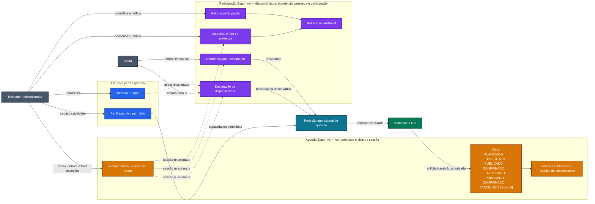
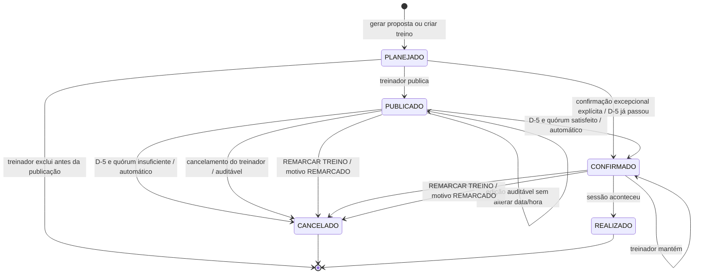

# CEPRAEA BEACH PRO — Diagramas e contrato do fluxo de treinamentos

## Metadados

| Campo | Valor |
| --- | --- |
| Status | `CANONICAL_DERIVED` — derivação lógica canônica das decisões de produto |
| Versão | 1.6 — proveniência `DECIDED`/`DERIVED` explicitada |
| Data | 02/09/2026 |
| Escopo | Primeira entrega operacional delimitada na elicitação |
| Fonte de produto | [`PRODUCT-DOMAIN-SPEC.md`](PRODUCT-DOMAIN-SPEC.md), Q-010 a Q-013 |
| Implementação técnica | `Not planned` |

## Finalidade

Este documento transforma as decisões consolidadas do produto em:

1. diagramas do fluxo de treinamentos;
2. contratos lógicos dos estados e condições;
3. contrato normativo das transições;
4. contrato ponta a ponta do fluxo operacional.

Os termos `DEVE`, `NÃO DEVE` e `PODE` são normativos.

## Escopo e autoridade

Ele não define tabelas, APIs, filas, jobs, schemas, serviços ou componentes de interface. Esses elementos pertencem ao planejamento técnico posterior e não podem alterar as regras lógicas aqui descritas.

As definições de produto e domínio pertencem ao [glossário normativo de `PRODUCT-DOMAIN-SPEC.md`](PRODUCT-DOMAIN-SPEC.md#glossário-normativo). Este contrato herda essas definições e pode detalhar comportamento, mas NÃO DEVE redefini-las nem atribuir-lhes significado arquitetural.

As regras substantivas de produto são `DECIDED` quando sustentadas pelo documento-fonte. A estrutura formal introduzida neste contrato — gatilhos, guardas, executores lógicos, agrupamentos e invariantes derivadas — possui proveniência `DERIVED`.

Uma derivação não pode ampliar a decisão de origem. Em caso de conflito semântico, `PRODUCT-DOMAIN-SPEC.md` prevalece e este contrato deve ser corrigido.

`OPEN-001` está fechado na elicitação: feriados nacionais e feriados oficiais estaduais ou municipais aplicáveis à cidade do Rio de Janeiro geram uma sessão possível na proposta mensal, sugerida entre 07h30 e 09h00. A proposta permanece sujeita à revisão humana antes da publicação.

## Glossário normativo

Este glossário define uma única vez apenas os termos próprios do contrato. Notas locais podem destacar a consequência de uma definição nesta seção, mas não podem substituí-la ou ampliá-la.

| Termo | Significado neste documento | Não implica |
| --- | --- | --- |
| `Contrato lógico` | Especificação normativa do comportamento, das autoridades, dos estados, das transições e das invariantes derivadas da elicitação. | Não implica arquitetura física, estrutura de código, banco de dados, API ou interface. |
| `Autoridade lógica` | Ator ou responsabilidade autorizada pelas regras de produto a declarar um dado, consolidar um fato ou decidir uma mudança. | Não implica papel de autenticação, política de acesso ou mecanismo técnico já escolhido. |
| `Executor lógico` | Ator ou responsabilidade conceitual autorizado a produzir determinada transição quando seu gatilho e sua guarda forem satisfeitos. | Não implica serviço, processo, job, função, endpoint, componente ou tecnologia específica. |
| `Automação` | Execução obrigatória de uma regra sem decisão humana no fluxo normal. | Não determina scheduler, job, cron, fila, função serverless ou mecanismo de execução. |
| `Gatilho` | Evento ou circunstância de negócio que inicia a avaliação de uma transição. | Não implica evento técnico, mensagem, webhook ou chamada de API. |
| `Guarda` | Condição que deve ser verdadeira para autorizar uma transição. | Não implica constraint de banco, validação de interface ou implementação específica. |
| `Transição` | Mudança autorizada entre estados da sessão, produzida por um gatilho com guarda e executor definidos. | Não implica endpoint, evento persistido ou troca de estado sem os efeitos obrigatórios. |
| `Efeito obrigatório` | Resultado observável que deve acompanhar uma transição ou operação para que o contrato seja cumprido. | Não determina estrutura de persistência, protocolo ou componente responsável por executá-lo. |
| `Invariante` | Regra que deve permanecer verdadeira em todos os estados, transições e operações aos quais se aplica. | Não implica que será implementada exclusivamente em uma camada ou por um tipo específico de validação. |
| `Projeção` | Leitura calculada a partir de dados de origem preservados, como quórum, déficit ou próxima ação. | Não é fonte de verdade, decisão humana, estado adicional da sessão nem estrutura técnica específica. |
| `Fonte de verdade` | Dado de origem cuja autoridade é definida pelo produto e que sustenta leituras e projeções derivadas. | Não implica banco, tabela, serviço ou repositório único já escolhido. |

Os termos `Agenda Esportiva`, `Participação Esportiva`, `Sessão de treino`, `Declaração`, `Fato`, `Disponibilidade`, `Ocorrência pós-fechamento`, `Presença`, `Participação`, `Perfil esportivo`, `Alocação da sessão`, `Quórum operacional`, `Projeção de quórum`, `Estado da sessão`, `Condição`, `D-5`, `Feriado aplicável no Rio de Janeiro`, `Fluxo normal`, `Confirmação excepcional`, `Remarcação`, `Cancelamento terminal` e `Retificação auditável` conservam exclusivamente o significado definido no glossário canônico do produto.

## Legenda conceitual de cores

As cores abaixo distinguem assuntos da elicitação somente nestes diagramas. Elas não são tokens do Design System nem definem componentes, módulos ou fronteiras da arquitetura.

| Cor | Significado |
| --- | --- |
| Azul `#2563EB` | Elenco e perfil esportivo |
| Laranja `#D97706` | `Agenda Esportiva`: compromisso e ciclo da sessão |
| Roxo `#7C3AED` | `Participação Esportiva`: disponibilidade, ocorrência, presença e participação |
| Verde `#047857` | Automação temporal e aplicação determinística de regras |
| Ciano `#0E7490` | Projeção ou cálculo composto, sem substituir o fato de origem |
| Cinza `#475569` | Ator humano |
| Vermelho `#B91C1C` | Exceção que exige decisão humana |

---

## Diagrama 1 — Separação conceitual e responsabilidades



### Leitura do diagrama

- O elenco reúne conceitualmente membro, papel e perfil esportivo.
- A `Agenda Esportiva` reúne conceitualmente o compromisso e seu ciclo.
- A `Participação Esportiva` reúne conceitualmente disponibilidade, ocorrência, presença, participação e retificação.
- A projeção de quórum compõe referências e fatos, mas não se torna fonte de verdade desses dados.
- A automação pode aplicar a mudança determinística prevista para D-5 sem transformar a projeção em fato de origem.
- Declarações e fatos individuais NÃO DEVEM alterar diretamente horário, local ou ciclo da sessão.

---

## Diagrama 2 — Fluxo operacional ponta a ponta

```mermaid
flowchart TD
    Start(["Início do ciclo mensal"])
    Generate["Gerar proposta mensal<br/>com sessões normais"]
    Holiday["Incluir sessões possíveis em feriados<br/>nacionais e oficiais aplicáveis ao Rio<br/>07h30–09h00"]
    Review["Revisar datas, horários e exceções"]
    Publish["PUBLICAR AGENDA"]
    Open["PUBLICADO<br/>DISPONIBILIDADE_ABERTA"]
    Declare["Atletas declaram ou alteram<br/>DISPONÍVEL / INDISPONÍVEL / TALVEZ"]
    Monitor["Calcular composição sem fechar a janela"]
    BeforeD5{"D-5 chegou?"}
    Close["Encerrar janela e preservar declarações"]
    Allocate["Buscar alocação válida<br/>4 Defesa + 4 Ataque<br/>8 distintas + Goleira na Defesa"]
    Enough{"Quórum satisfeito?"}
    Confirm["CONFIRMADO<br/>automático"]
    CancelNoQuorum["CANCELADO<br/>motivo: FALTA_DE_QUÓRUM"]
    PostOccurrence{"Houve ocorrência<br/>pós-fechamento?"}
    RecordOccurrence["Registrar NÃO PODEREI COMPARECER<br/>ou AGORA POSSO PARTICIPAR<br/>sem reescrever a declaração original"]
    Recalculate["Recalcular quórum atual"]
    StillEnough{"Composição continua válida?"}
    Exception["QUÓRUM_COMPROMETIDO<br/>com diagnóstico do déficit"]
    CoachDecision["Treinador decide:<br/>MANTER TREINO ou CANCELAR TREINO"]
    Keep["Permanece CONFIRMADO"]
    CancelDecision["CANCELADO<br/>por decisão posterior"]
    SessionHappens["Sessão acontece"]
    Realized["REALIZADO"]
    Assess["Apurar presença e participação"]
    Consolidate["Consolidar fato pelo treinador"]
    ErrorFound{"Erro factual identificado?"}
    Rectify["Se houver erro factual:<br/>retificação auditável"]
    History["Histórico e métricas operacionais"]

    Start --> Generate --> Holiday --> Review --> Publish --> Open
    Open --> Declare --> Monitor --> BeforeD5
    BeforeD5 -->|não| Declare
    BeforeD5 -->|sim| Close --> Allocate --> Enough
    Enough -->|sim| Confirm
    Enough -->|não| CancelNoQuorum --> History
    Confirm --> PostOccurrence
    PostOccurrence -->|não| SessionHappens
    PostOccurrence -->|sim| RecordOccurrence --> Recalculate --> StillEnough
    StillEnough -->|sim| Keep --> SessionHappens
    StillEnough -->|não| Exception --> CoachDecision
    CoachDecision -->|manter| Keep
    CoachDecision -->|cancelar| CancelDecision --> History
    SessionHappens --> Realized --> Assess --> Consolidate --> ErrorFound
    ErrorFound -->|não| History
    ErrorFound -->|sim| Rectify --> History

    classDef actor fill:#475569,stroke:#1E293B,color:#FFFFFF,stroke-width:2px;
    classDef agenda fill:#D97706,stroke:#92400E,color:#FFFFFF,stroke-width:2px;
    classDef participation fill:#7C3AED,stroke:#4C1D95,color:#FFFFFF,stroke-width:2px;
    classDef automation fill:#047857,stroke:#064E3B,color:#FFFFFF,stroke-width:2px;
    classDef projection fill:#0E7490,stroke:#164E63,color:#FFFFFF,stroke-width:2px;
    classDef exception fill:#B91C1C,stroke:#7F1D1D,color:#FFFFFF,stroke-width:2px;

    class Review,CoachDecision actor;
    class Generate,Holiday,Publish,Open,Confirm,CancelNoQuorum,Keep,CancelDecision,SessionHappens,Realized,History agenda;
    class Declare,RecordOccurrence,Assess,Consolidate,Rectify participation;
    class Close automation;
    class Monitor,Allocate,Recalculate projection;
    class Exception,ErrorFound exception;
```



---

## Diagrama 3 — Máquina de estados da sessão



Uma remarcação cria outra sessão sem transportar declarações de disponibilidade da original. Se o novo D-5 estiver no futuro, a nova sessão entra em `PUBLICADO`; se já tiver passado, permanece `PLANEJADO` até o treinador confirmá-la explicitamente como sessão excepcional.

`DISPONIBILIDADE_ABERTA`, `QUÓRUM_GARANTIDO` e `QUÓRUM_COMPROMETIDO` não aparecem como estados da máquina porque são condições ou projeções. Elas não substituem o ciclo pertencente à `Agenda Esportiva`.

---

## Diagrama 4 — Dimensões independentes de Participação Esportiva

```mermaid
flowchart LR
    subgraph AvailabilityAxis["Disponibilidade — declaração anterior"]
        NoResponse["NÃO RESPONDEU"]
        Available["DISPONÍVEL"]
        Unavailable["INDISPONÍVEL"]
        Maybe["TALVEZ"]
        D5Snapshot["D-5: declaração preservada<br/>não é um novo estado de resposta"]

        NoResponse -->|declarar antes de D-5| Available
        NoResponse -->|declarar antes de D-5| Unavailable
        NoResponse -->|declarar antes de D-5| Maybe
        Available <-->|alterar antes de D-5| Unavailable
        Available <-->|alterar antes de D-5| Maybe
        Unavailable <-->|alterar antes de D-5| Maybe
        NoResponse --> D5Snapshot
        Available --> D5Snapshot
        Unavailable --> D5Snapshot
        Maybe --> D5Snapshot
    end

    subgraph OccurrenceAxis["Depois de D-5 — evento complementar"]
        PostOccurrence["NÃO PODEREI COMPARECER<br/>ou AGORA POSSO PARTICIPAR"]
        Preserve["Preserva declaração original,<br/>autoria, motivo e data/hora"]
        CurrentEffect["Recalcula o quórum atual"]
        PostOccurrence --> Preserve --> CurrentEffect
    end

    subgraph PresenceAxis["Presença — fato observado"]
        NotAssessed["NÃO APURADO"]
        Present["PRESENTE"]
        Absent["AUSENTE"]
        AuditRectification["RETIFICAÇÃO AUDITÁVEL<br/>sem sobrescrita"]
        NotAssessed -->|consolidação do treinador| Present
        NotAssessed -->|consolidação do treinador| Absent
        Present -->|erro factual| AuditRectification
        Absent -->|erro factual| AuditRectification
        AuditRectification --> Present
        AuditRectification --> Absent
    end

    subgraph ParticipationAxis["Participação — realização esportiva"]
        NotMeasured["NÃO APURADA"]
        Complete["COMPLETA"]
        Partial["PARCIAL"]
        DidNotParticipate["NÃO PARTICIPOU"]
        ParticipationRectification["RETIFICAÇÃO AUDITÁVEL<br/>sem sobrescrita"]
        NotMeasured -->|consolidação do treinador| Complete
        NotMeasured -->|consolidação do treinador| Partial
        NotMeasured -->|consolidação do treinador| DidNotParticipate
        Complete -->|erro factual| ParticipationRectification
        Partial -->|erro factual| ParticipationRectification
        DidNotParticipate -->|erro factual| ParticipationRectification
        ParticipationRectification --> Complete
        ParticipationRectification --> Partial
        ParticipationRectification --> DidNotParticipate
    end

    D5Snapshot -.->|não se transforma em presença| NotAssessed
    CurrentEffect -.->|não reescreve o passado| D5Snapshot
    Present -.->|dimensão independente| Complete
    Present -.->|dimensão independente| Partial
    Present -.->|dimensão independente| DidNotParticipate
    Absent -.->|combinação válida| DidNotParticipate
    NotAssessed -.->|combinação inicial| NotMeasured

    classDef availability fill:#7C3AED,stroke:#4C1D95,color:#FFFFFF,stroke-width:2px;
    classDef occurrence fill:#9333EA,stroke:#581C87,color:#FFFFFF,stroke-width:2px;
    classDef presence fill:#6D28D9,stroke:#4C1D95,color:#FFFFFF,stroke-width:2px;
    classDef participation fill:#5B21B6,stroke:#3B0764,color:#FFFFFF,stroke-width:2px;

    class NoResponse,Available,Unavailable,Maybe,D5Snapshot availability;
    class PostOccurrence,Preserve,CurrentEffect occurrence;
    class NotAssessed,Present,Absent,AuditRectification presence;
    class NotMeasured,Complete,Partial,DidNotParticipate,ParticipationRectification participation;
```



---

# Contrato dos estados

## 1. Estado da sessão

Responsabilidade lógica: ciclo da sessão.

| Estado | Significado canônico | Entrada autorizada | Saídas autorizadas | Invariantes |
| --- | --- | --- | --- | --- |
| `PLANEJADO` | Sessão proposta ou criada, ainda fora do calendário oficial publicado. | Geração recorrente ou criação pelo treinador/admin. | `PUBLICADO`, `CONFIRMADO` por exceção ou exclusão antes da publicação. | Pode ser editada ou excluída; confirmação direta exige D-5 já transcorrido e ação explícita. |
| `PUBLICADO` | Intenção oficial de realizar a sessão, com data, horário, local e D-5 visíveis. | Publicação pelo treinador/admin. | `CONFIRMADO` ou `CANCELADO`. | Publicação não significa confirmação; data e horário somente mudam por remarcação. |
| `CONFIRMADO` | Compromisso de realização assumido. | Resolução automática de D-5 com quórum satisfeito ou confirmação excepcional explícita quando a sessão é criada com D-5 já transcorrido. | `REALIZADO`, `CANCELADO` ou permanência em `CONFIRMADO`. | Ocorrência posterior nunca cancela automaticamente; condição comprometida não muda o estado. |
| `CANCELADO` | Sessão não será realizada, com motivo e proveniência preservados. | Automação em D-5 por `FALTA_DE_QUÓRUM`, remarcação ou decisão do treinador/admin. | Nenhuma. | É terminal; não aceita reativação nem novas ocorrências e não pode desaparecer do histórico. |
| `REALIZADO` | Sessão efetivamente aconteceu. | Registro do fato de realização no ciclo da `Agenda Esportiva`. | Nenhuma saída definida neste contrato. | Não determina presença individual; a apuração pertence à `Participação Esportiva`. |

### Regras do ciclo

- Uma sessão DEVE possuir exatamente um estado corrente do ciclo.
- Condição de quórum NÃO DEVE ser armazenada ou apresentada como estado do ciclo.
- Uma edição depois da publicação DEVE preservar os valores originalmente publicados, novos valores, autoria e data/hora.
- Data ou horário de sessão `PUBLICADO` ou `CONFIRMADO` NÃO DEVEM ser alterados por edição direta; a operação obrigatória é `REMARCAR TREINO`.
- `REMARCAR TREINO` DEVE cancelar a sessão original com motivo `REMARCADO` e criar outra sessão sem transportar declarações de disponibilidade.
- `CONFIRMADO` NÃO DEVE ser produzido antes de D-5 no fluxo normal.
- Quando uma nova sessão é criada com D-5 já transcorrido, somente a confirmação excepcional explícita do treinador/admin PODE produzir `CONFIRMADO`.
- `CANCELADO` por `FALTA_DE_QUÓRUM` somente pode ser produzido automaticamente no fechamento de uma sessão ainda `PUBLICADO`.
- Uma sessão `CONFIRMADO` somente pode ser cancelada por decisão do treinador/admin.
- Toda sessão `CANCELADO` é terminal e NÃO PODE ser reativada.

## 2. Condições e projeções da sessão

Autoridade sobre o dado de origem: conforme o fato ou a declaração. Responsável pela composição: projeção operacional, sem se tornar fonte de verdade.

| Condição ou projeção | Quando se aplica | Efeito permitido | Proibição |
| --- | --- | --- | --- |
| `DISPONIBILIDADE_ABERTA` | Sessão `PUBLICADO` antes de D-5. | Permitir declarações e alterações ordinárias. | Não confirma a sessão. |
| `QUÓRUM_EM_FORMAÇÃO` | Antes de D-5, sem composição garantida. | Mostrar progresso e déficit sem exigir decisão semanal do treinador. | Não equivale a cancelamento. |
| `QUÓRUM_GARANTIDO` | Antes de D-5, existe ao menos uma composição válida. | Informar que a condição já está satisfeita. | Não fecha a janela nem antecipa `CONFIRMADO`. |
| `FALTA_DE_QUÓRUM` | Em D-5, não existe composição operacional válida. | Motivar `CANCELADO` automático e permanecer no histórico. | Não cria `AGUARDANDO_DECISÃO_DO_TREINADOR`. |
| `QUÓRUM_COMPROMETIDO` | Uma ocorrência posterior reduz uma sessão confirmada abaixo do mínimo ou inviabiliza a composição. | Alertar o treinador, informar o déficit exato — inclusive capacidade obrigatória ausente — e solicitar `MANTER TREINO` ou `CANCELAR TREINO`. | Não cancela automaticamente e não cria outra classificação de exceção. |

## 3. Estado da disponibilidade por atleta e sessão

Autoridade lógica: declaração da atleta para uma sessão.

| Estado | Natureza | Conta no quórum? | Autoridade | Regra |
| --- | --- | ---: | --- | --- |
| `NÃO RESPONDEU` | Ausência de declaração. | Não | Sistema apenas projeta a ausência de resposta. | Nunca vira `INDISPONÍVEL`, `AUSENTE` ou resposta negativa. |
| `DISPONÍVEL` | Declaração positiva da atleta. | Sim | Atleta, durante a janela ordinária. | Pode preencher uma única vaga na composição. |
| `INDISPONÍVEL` | Declaração negativa da atleta. | Não | Atleta, durante a janela ordinária. | Motivo curto é declaração, não diagnóstico nem presença. |
| `TALVEZ` | Declaração de incerteza. | Não | Atleta, durante a janela ordinária. | Permanece distinto de resposta negativa e de ausência de resposta. |

### Regras da disponibilidade

- Antes de D-5, a atleta PODE alterar a própria resposta ordinária.
- No instante de D-5, a janela ordinária DEVE ser encerrada e as declarações existentes preservadas.
- Depois de D-5, nenhuma resposta ordinária pode ser reescrita retroativamente.
- Um imprevisto posterior DEVE ser registrado como `OCORRÊNCIA_PÓS_FECHAMENTO`.
- A mesma pessoa física NÃO DEVE preencher mais de uma vaga do quórum.

## 4. Ocorrências depois de D-5

Uma ocorrência posterior é um evento complementar da atleta em uma sessão `CONFIRMADO`; não é uma nova declaração ordinária.

| Ação | Efeito corrente | Preservação obrigatória |
| --- | --- | --- |
| `NÃO PODEREI COMPARECER` | Retira imediatamente a atleta da composição atual e recalcula o quórum. | Declaração existente, atleta afetada, autor real do registro e data/hora. |
| `AGORA POSSO PARTICIPAR` | Inclui imediatamente a atleta como candidata, respeitando seu perfil esportivo, e recalcula o quórum. | Declaração existente, atleta afetada, autor real do registro e data/hora. |

- Se a nova composição for válida, a sessão permanece `CONFIRMADO` e um alerta pendente de `QUÓRUM_COMPROMETIDO` DEVE ser encerrado.
- Se a composição deixar de ser válida, a sessão permanece `CONFIRMADO` com `QUÓRUM_COMPROMETIDO` até o treinador escolher `MANTER TREINO` ou `CANCELAR TREINO`.
- Uma sessão `CANCELADO` NÃO PODE receber ocorrência nem voltar ao fluxo ativo.

## 5. Estados da presença e da participação

Autoridade lógica: fatos de presença e participação, mantidos em dimensões separadas.

### Presença

| Estado | Significado | Autoridade |
| --- | --- | --- |
| `NÃO APURADO` | Ainda não existe fato oficial de comparecimento. | Estado inicial da apuração. |
| `PRESENTE` | A atleta compareceu à sessão. | Consolidação pelo treinador/admin. |
| `AUSENTE` | A atleta não compareceu à sessão. | Consolidação pelo treinador/admin. |

### Participação

| Estado | Significado | Autoridade |
| --- | --- | --- |
| `NÃO APURADA` | Ainda não existe fato oficial sobre a realização esportiva. | Estado inicial da apuração. |
| `COMPLETA` | A atleta realizou integralmente a sessão. | Consolidação pelo treinador/admin. |
| `PARCIAL` | A atleta realizou parte da sessão. | Consolidação pelo treinador/admin. |
| `NÃO PARTICIPOU` | A atleta não realizou nenhuma parte da sessão, tenha comparecido ou não. | Consolidação pelo treinador/admin. |

### Combinações válidas

| Presença | Participação | Significado |
| --- | --- | --- |
| `PRESENTE` | `COMPLETA` | Compareceu e realizou integralmente a sessão. |
| `PRESENTE` | `PARCIAL` | Compareceu e realizou parte da sessão. |
| `PRESENTE` | `NÃO PARTICIPOU` | Compareceu, mas não realizou nenhuma parte da sessão. |
| `AUSENTE` | `NÃO PARTICIPOU` | Não compareceu e não realizou a sessão. |
| `NÃO APURADO` | `NÃO APURADA` | Os fatos ainda não foram consolidados. |

### Invariantes factuais

- `Disponibilidade ≠ Presença ≠ Participação`.
- `NÃO APURADO` NÃO DEVE virar automaticamente `PRESENTE` ou `AUSENTE`.
- `NÃO APURADA` NÃO DEVE virar automaticamente um resultado de participação.
- Wellness, timestamps e interações PODEM ser evidências futuras, mas NÃO determinam presença.
- Uma atleta `PRESENTE` pode ter participação `COMPLETA`, `PARCIAL` ou `NÃO PARTICIPOU`.
- Uma atleta `AUSENTE` DEVE possuir participação `NÃO PARTICIPOU` na mesma consolidação factual.
- `AUSENTE + COMPLETA` e `AUSENTE + PARCIAL` são combinações inválidas.
- `NÃO APURADO` somente pode ser combinado com `NÃO APURADA`.
- Depois da consolidação definitiva, `PRESENTE` ou `AUSENTE` NÃO DEVE permanecer combinado com `NÃO APURADA`.
- O registro conjunto de `AUSENTE + NÃO PARTICIPOU` decorre da consolidação realizada pelo treinador/admin e NÃO DEVE ser inferido de Wellness, timestamps, interações ou ausência de apuração.
- Um problema depois da chegada não transforma `PRESENTE` em `AUSENTE`.
- Atletas NÃO possuem autoridade para consolidar, alterar ou retificar presença ou participação.

## 6. Contrato da retificação de presença e participação

`RETIFICAÇÃO` é um evento auditável, não um novo estado de presença ou participação.

| Campo obrigatório | Regra |
| --- | --- |
| Valor anterior | DEVE preservar o fato consolidado que está sendo corrigido. |
| Novo valor | DEVE registrar o fato corrente após a correção. |
| Motivo | DEVE explicar o erro factual corrigido. |
| Autor | DEVE identificar o treinador/administrador responsável. |
| Data e hora | DEVEM registrar o instante da retificação. |

Regras:

- o registro original NÃO DEVE ser apagado ou sobrescrito;
- a leitura corrente DEVE considerar o novo valor;
- o histórico DEVE permitir reconstruir o valor original e a retificação;
- somente treinador/administrador pode executar a operação;
- quando a correção de um eixo tornar inválida a combinação Presença × Participação, os dois eixos DEVEM ser retificados conjuntamente para produzir uma combinação válida;
- o contrato lógico não prescreve tabela, estrutura de evento ou estratégia de persistência.

---

# Contrato das transições

### Regra de interpretação desta seção

- A coluna `Executor lógico` aplica a definição do glossário para identificar a responsabilidade autorizada a produzir a transição. Ela não prescreve o mecanismo técnico de execução.
- Quando o executor contém `Automação`, a transição ocorre sem decisão humana no fluxo normal. O termo não escolhe scheduler, job, cron, fila ou função.
- `Agenda Esportiva`, `Participação Esportiva` e `Projeção de quórum` conservam o significado canônico do produto; nesta seção, indicam responsabilidades conceituais e não fronteiras arquiteturais.

## 1. Transições do ciclo da sessão

| ID | Origem | Gatilho e guarda | Destino | Executor lógico | Efeitos obrigatórios |
| --- | --- | --- | --- | --- | --- |
| `TR-SES-001` | inexistente | Proposta recorrente gerada ou criação manual autorizada. | `PLANEJADO` | `Agenda Esportiva` / treinador-admin | Registrar data, horário, local e origem da criação. |
| `TR-SES-002` | `PLANEJADO` | Treinador/admin conclui a revisão e publica com D-5 futuro. | `PUBLICADO` | Treinador/admin | Tornar calendário oficial, abrir disponibilidade e calcular D-5. |
| `TR-SES-003` | `PUBLICADO` | Instante D-5 e composição válida. | `CONFIRMADO` | Automação conforme as regras do ciclo | Encerrar janela, preservar respostas, registrar composição e comunicar atletas. |
| `TR-SES-004` | `PUBLICADO` | Instante D-5 e nenhuma composição válida. | `CANCELADO` | Automação conforme as regras do ciclo | Registrar motivo `FALTA_DE_QUÓRUM`, preservar sessão e comunicar atletas. |
| `TR-SES-005` | `PUBLICADO` | Cancelamento explícito autorizado. | `CANCELADO` | Treinador/admin | Preservar versão publicada, motivo, autoria e data/hora. |
| `TR-SES-006` | `CONFIRMADO` | Ocorrência posterior; composição continua válida. | `CONFIRMADO` | `Participação Esportiva` + `Projeção de quórum` | Preservar ocorrência, recalcular e comunicar somente mudança relevante. |
| `TR-SES-007` | `CONFIRMADO` | Ocorrência produz `QUÓRUM_COMPROMETIDO`. | `CONFIRMADO` | `Participação Esportiva` + `Projeção de quórum` | Alertar treinador com o déficit exato; não cancelar. |
| `TR-SES-008` | `CONFIRMADO` | Treinador escolhe `MANTER TREINO`. | `CONFIRMADO` | Treinador/admin | Registrar somente a decisão, autoria e data/hora. |
| `TR-SES-009` | `CONFIRMADO` | Treinador decide cancelar depois de uma exceção ou mudança real. | `CANCELADO` | Treinador/admin | Registrar decisão, motivo, autoria, data/hora e comunicar atletas. |
| `TR-SES-010` | `CONFIRMADO` | A sessão efetivamente aconteceu e o fato foi registrado. | `REALIZADO` | `Agenda Esportiva` | Preservar o ciclo da sessão sem inferir presença individual. |
| `TR-SES-011` | `PLANEJADO` | D-5 já transcorreu e treinador escolhe `CONFIRMAR SESSÃO EXCEPCIONAL`. | `CONFIRMADO` | Treinador/admin | Registrar confirmação explícita, autoria e data/hora e comunicar atletas. |
| `TR-SES-012` | `PUBLICADO` ou `CONFIRMADO` | Treinador escolhe `REMARCAR TREINO`. | `CANCELADO` | Treinador/admin | Registrar motivo `REMARCADO`; preservar a original; criar outra sessão sem declarações: `PUBLICADO` se o novo D-5 for futuro ou `PLANEJADO` para confirmação excepcional se já tiver passado. |

### Operações que não criam novo estado

| Operação | Regra |
| --- | --- |
| Excluir sessão `PLANEJADO` | Permitido antes da publicação; não equivale a cancelar uma sessão publicada. |
| Editar sessão depois da publicação | Mantém o estado aplicável e cria alteração auditável; não permite alterar data ou horário. |
| Remarcar sessão publicada ou confirmada | Cancela a original com motivo `REMARCADO` e cria outra sem transportar declarações; a nova entra em `PUBLICADO` com D-5 futuro ou aguarda confirmação excepcional se o prazo passou. |
| Recalcular quórum | Atualiza condição/projeção; não altera o ciclo por si só. |
| Registrar ocorrência pós-fechamento | Acrescenta um novo fato; não reescreve a disponibilidade original. |
| Retificar presença ou participação | Atualiza a leitura factual por evento auditável; não sobrescreve o registro consolidado. |

## 2. Contrato do checkpoint D-5

Definição canônica:

```text
D-5 = início_da_sessão − 120 horas
```

No instante exato de D-5, para cada sessão `PUBLICADO`, independentemente de ser recorrente ou excepcional, o fluxo DEVE:

1. encerrar a disponibilidade ordinária;
2. preservar todas as declarações existentes, inclusive `TALVEZ` e `NÃO RESPONDEU`;
3. selecionar somente pessoas `DISPONÍVEL` como candidatas ao quórum;
4. considerar posição principal obrigatória e posição secundária opcional;
5. buscar uma alocação com oito pessoas distintas;
6. preencher quatro vagas de Ataque;
7. preencher quatro vagas de Defesa;
8. exigir ao menos uma Goleira dentro das quatro pessoas da Defesa;
9. impedir dupla contagem entre posições ou fases;
10. produzir exatamente um resultado de ciclo: `CONFIRMADO` ou `CANCELADO` por `FALTA_DE_QUÓRUM`;
11. comunicar o resultado;
12. preservar dados suficientes para auditoria e métricas.

Uma sessão criada quando seu D-5 já passou NÃO executa retroativamente esse checkpoint. Ela exige a escolha explícita `CONFIRMAR SESSÃO EXCEPCIONAL` e entra diretamente em `CONFIRMADO`, sem fingir uma resolução automática de quórum.

---

# Contrato do fluxo

## 1. Pré-condições

- existe recorrência configurada para geração da proposta mensal;
- feriados nacionais e feriados oficiais estaduais ou municipais aplicáveis à cidade do Rio de Janeiro podem ser identificados antes da revisão;
- o treinador/admin possui autoridade operacional;
- atletas possuem referências e capacidades esportivas utilizáveis;
- a sessão possui início, fim, local e D-5 determinável;
- o ciclo da sessão, as declarações, os fatos individuais e as projeções permanecem logicamente distintos.

## 2. Etapas e pós-condições

| Etapa | Responsabilidade | Entrada | Saída / pós-condição |
| --- | --- | --- | --- |
| `FLW-001` — Gerar agenda | `Agenda Esportiva` | Recorrência, feriados aplicáveis e período mensal. | Sessões normais e sessões possíveis em feriados no estado `PLANEJADO`; horário de feriado sugerido como 07h30–09h00, sem duplicar recorrência coincidente. |
| `FLW-002` — Revisar | `Agenda Esportiva` + treinador | Proposta mensal. | Datas e exceções verificadas; painel continua disponível depois. |
| `FLW-003` — Publicar | `Agenda Esportiva` + treinador | Sessão revisada com D-5 futuro. | Sessão `PUBLICADO`, calendário oficial e disponibilidade aberta. |
| `FLW-004` — Coletar declarações | `Participação Esportiva` + atleta | Sessão publicada antes de D-5. | Respostas explícitas ou `NÃO RESPONDEU`, sempre distinguíveis. |
| `FLW-005` — Projetar quórum | `Projeção de quórum` | Perfis permitidos e declarações atuais. | Condição atual e déficit exato, sem produzir decisão humana. |
| `FLW-006` — Resolver D-5 | `Automação` + `Agenda Esportiva` | Sessão publicada no instante D-5. | `CONFIRMADO` ou `CANCELADO` por `FALTA_DE_QUÓRUM`, sem ação semanal do treinador. |
| `FLW-007` — Tratar ocorrência | `Participação Esportiva` | Sessão confirmada e ação `NÃO PODEREI COMPARECER` ou `AGORA POSSO PARTICIPAR`. | Evento preservado, atleta retirada ou incluída na composição atual, quórum recalculado e alerta atualizado. |
| `FLW-008` — Decidir exceção | Treinador + `Agenda Esportiva` | `QUÓRUM_COMPROMETIDO` depois da confirmação. | `MANTER TREINO`, permanecendo `CONFIRMADO`, ou `CANCELAR TREINO`, produzindo `CANCELADO`. |
| `FLW-009` — Registrar realização | `Agenda Esportiva` | Sessão confirmada que aconteceu. | Sessão `REALIZADO`; não implica presença automática. |
| `FLW-010` — Consolidar fatos | `Participação Esportiva` + treinador | Evidências da sessão realizada. | Presença e participação factual por atleta. |
| `FLW-011` — Retificar erro factual | `Participação Esportiva` + treinador | Presença ou participação consolidada com erro identificado. | Novo valor corrente, combinação válida e cadeia de auditoria preservada. |
| `FLW-012` — Projetar histórico | `Projeção` | Ciclos e fatos preservados. | Métricas operacionais sem ranking ou culpabilização individual. |
| `FLW-013` — Criar sessão excepcional | `Agenda Esportiva` + treinador | Nova sessão cujo D-5 já transcorreu. | `CONFIRMAR SESSÃO EXCEPCIONAL` produz `CONFIRMADO`; `VOLTAR` mantém `PLANEJADO`. |
| `FLW-014` — Remarcar | `Agenda Esportiva` + treinador | Sessão `PUBLICADO` ou `CONFIRMADO` com data/horário a alterar. | Original `CANCELADO` por `REMARCADO`; nova sessão sem declarações, `PUBLICADO` com D-5 futuro ou `PLANEJADO` para confirmação excepcional se o prazo passou. |

## 3. Autorizações lógicas

| Ator | Pode | Não pode |
| --- | --- | --- |
| Atleta | Declarar ou alterar a própria disponibilidade antes de D-5; escolher `NÃO PODEREI COMPARECER` ou `AGORA POSSO PARTICIPAR` depois de D-5 em sessão confirmada. | Publicar, confirmar, remarcar ou cancelar sessão; consolidar ou retificar presença/participação; alterar perfil esportivo. |
| Treinador/admin | Criar, editar proposta, publicar, excluir/cancelar/remarcar treinos; confirmar sessão excepcional; cadastrar posições; registrar ocorrência recebida; escolher `MANTER TREINO` ou `CANCELAR TREINO`; consolidar e retificar presença/participação. | Sobrescrever silenciosamente histórico; apresentar projeção automática como decisão humana; reativar sessão cancelada. |
| Sistema | Gerar proposta; aplicar feriado; calcular D-5; enviar lembretes; calcular quórum; confirmar/cancelar automaticamente em D-5; recalcular e alertar. | Cancelar automaticamente sessão já confirmada; converter ausência de resposta em resposta negativa; inferir presença; cadastrar ou considerar participante convidada. |

Quando o treinador registrar uma ocorrência em nome da atleta, o histórico DEVE distinguir a atleta afetada do autor real do registro.

## 4. Contrato da comunicação

- Publicação DEVE comunicar pendência de disponibilidade.
- Resolução em D-5 DEVE comunicar confirmação ou cancelamento por falta de quórum.
- Alteração relevante depois da confirmação DEVE comunicar o estado operacional necessário sem expor matemática interna ou dados individuais desnecessários.
- Cancelamento posterior DEVE ser distinguido do cancelamento automático por falta de quórum.
- Remarcação DEVE informar que o compromisso original foi cancelado e solicitar nova disponibilidade quando a nova sessão seguir o fluxo normal.
- Para o treinador, `QUÓRUM_COMPROMETIDO` DEVE expor o déficit exato; para as atletas, a comunicação DEVE permanecer simples e orientada ao estado do treino.
- Mensagens NÃO DEVEM culpabilizar atletas nem produzir ranking constrangedor.

## 5. Contrato do histórico e das métricas

O histórico DEVE permitir distinguir e contar:

- sessões publicadas;
- sessões resolvidas automaticamente em D-5;
- sessões confirmadas automaticamente;
- sessões confirmadas excepcionalmente pelo treinador;
- sessões canceladas automaticamente por `FALTA_DE_QUÓRUM`;
- sessões canceladas por `REMARCADO` e novas sessões originadas por remarcação;
- sessões que exigiram intervenção depois da confirmação;
- decisões `MANTER TREINO` e `CANCELAR TREINO` após quórum comprometido;
- sessões efetivamente realizadas;
- sessões canceladas por decisão posterior;
- ações administrativas do treinador no fluxo normal.

O indicador principal do MVP é:

```text
ações administrativas obrigatórias do treinador no fluxo semanal normal = 0
```

Horas economizadas permanecem indicador futuro, condicionado a uma baseline real de uso.

## 6. Invariantes transversais

1. `NÃO RESPONDEU ≠ INDISPONÍVEL`.
2. `Disponibilidade ≠ Presença ≠ Participação`.
3. Planejamento, declaração, projeção e fato não compartilham um estado ambíguo.
4. Quórum calculado não é decisão humana.
5. O cálculo não pode criar oito vagas usando menos de oito pessoas distintas.
6. `QUÓRUM_GARANTIDO` antes de D-5 não confirma a sessão.
7. Falta de quórum em D-5 cancela automaticamente uma sessão ainda não confirmada.
8. Perda de quórum depois da confirmação nunca cancela automaticamente.
9. Sessão publicada ou cancelada não desaparece silenciosamente.
10. Presença ou participação consolidada somente pode ser corrigida por retificação auditável do treinador/admin.
11. Projeções e painéis não são fontes de verdade concorrentes.
12. A estrutura técnica futura não pode fundir ou redefinir os fatos e ciclos distintos confirmados na elicitação.
13. Participantes convidadas não são cadastradas, consultadas, registradas nem consideradas no cálculo de quórum.
14. `QUÓRUM_COMPROMETIDO` é a única condição de exceção pós-confirmação; uma capacidade obrigatória ausente é diagnóstico, não outra condição.
15. Toda sessão `CANCELADO` é terminal.
16. Remarcação preserva a sessão original, cria outra sessão e não transporta declarações de disponibilidade.
17. Toda consolidação ou retificação deve resultar em combinação válida de Presença × Participação.

## 7. Limites técnicos futuros

Permanecem fora deste contrato lógico:

- formato de API e comandos;
- estrutura de banco e constraints físicas;
- scheduler e estratégia de execução de D-5;
- implementação de notificações;
- estratégia offline e resolução de concorrência;
- tratamento idempotente e reprocessamento do checkpoint D-5, preservados como necessidades técnicas candidatas `INF` para Requirements/Drivers, sem promoção a regra de domínio confirmada;
- provedor e cache de feriados;
- componentes e tokens do Design System.

---

## Critérios de conformidade para uma implementação futura

Uma implementação somente poderá declarar conformidade com este contrato quando houver evidência de que:

- o ciclo da sessão, as declarações, os fatos individuais e as projeções permanecem separados;
- as relações entre atleta, sessão, declarações e fatos são explícitas sem impor uma estrutura técnica específica;
- estados, condições e fatos não foram fundidos;
- transições automáticas e humanas respeitam suas guardas e autoridades;
- autorização impede atleta de consolidar ou retificar presença ou participação;
- D-5 produz um único resultado determinístico;
- cancelamento é terminal e não admite reativação ou novas ocorrências;
- remarcação preserva a sessão original e não transporta disponibilidades;
- sessões criadas com D-5 transcorrido exigem confirmação excepcional explícita;
- ocorrências negativas e positivas produzem efeitos simétricos sobre a composição atual;
- participante convidada não integra o produto nem o cálculo de quórum;
- histórico e retificação de presença/participação são auditáveis;
- testes provam pelo menos `NÃO RESPONDEU ≠ INDISPONÍVEL`, `NÃO APURADO ≠ PRESENTE/AUSENTE` e ausência de cancelamento automático depois da confirmação;
- testes provam as combinações válidas entre Presença e Participação e rejeitam combinações factuais contraditórias;
- projeções não se tornaram fontes de verdade concorrentes.

Este documento descreve o comportamento desejado. Sua existência não altera o estado `Not planned` da implementação técnica e não autoriza implementação.
